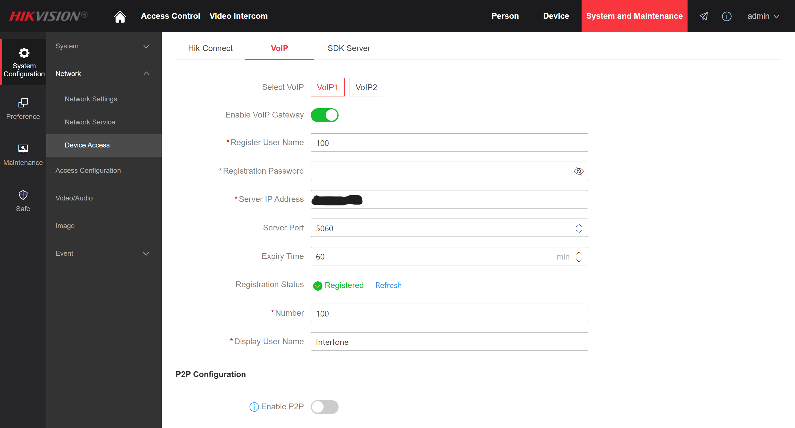
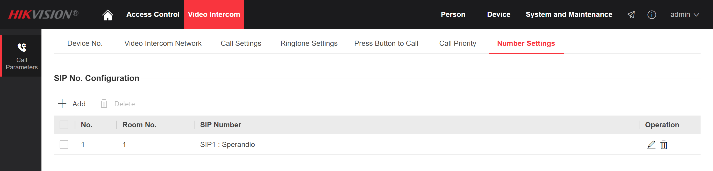
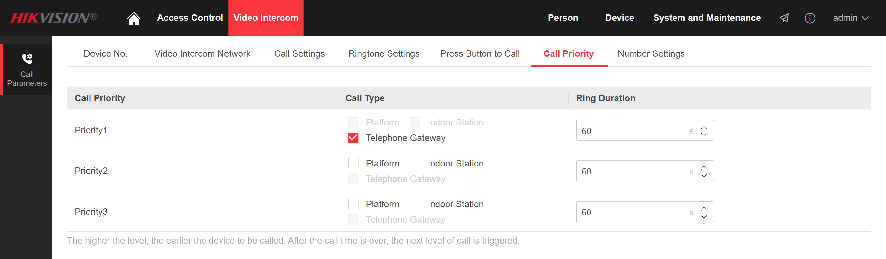

<p align="center">
  <picture>
    <source media="(prefers-color-scheme: dark)" srcset="https://raw.githubusercontent.com/webysther/ha-hikvision-virtual-indoor-station/main/custom_components/hikvision_virtual_indoor_station/brand/dark_logo@2x.png">
    
  </picture>
</p>

<h1 align="center">Hikvision Virtual Indoor Station</h1>

<p align="center">Home Assistant come posto interno del tuo citofono Hikvision: rispondi, parla e apri la porta dalle plance e dai telefoni</p>

<p align="center">
  <a href="https://github.com/webysther/ha-hikvision-virtual-indoor-station/releases/latest"></a>
  <a href="https://www.home-assistant.io/integrations/marketplace/"></a>
  <a href="https://github.com/webysther/ha-hikvision-virtual-indoor-station/actions/workflows/tests.yaml"></a>
  <a href="https://github.com/webysther/ha-hikvision-virtual-indoor-station/blob/main/LICENSE"></a>
</p>

<p align="center"><a href="https://github.com/webysther/ha-hikvision-virtual-indoor-station/blob/main/README.md">English</a> · <b>Italiano</b> · <a href="https://github.com/webysther/ha-hikvision-virtual-indoor-station/blob/main/README.pt-BR.md">Português (Brasil)</a></p>

Fai di Home Assistant il posto interno del tuo citofono video Hikvision. Il suo
pulsante suona in Home Assistant, sulle tue plance e sui telefoni: rispondi,
parli, riagganci o rifiuti la chiamata, e apri la porta.

> **Stato: in sviluppo.** Provato con un DS-KD8003-IME1(B), firmware V3.7.3.

## Perché questa integrazione

- **Tutto in uno.** Il server SIP che il citofono chiama, la scheda e una plancia
  disegnata come lo schermo di un posto interno arrivano con l'integrazione:
  nessun add-on, server SIP, broker MQTT o account cloud da configurare accanto.
- **Ibrida, il meglio di ogni protocollo.** SIP porta la chiamata, come il
  citofono si aspetta da un posto interno; RTP porta la tua voce alla porta, nei
  pacchetti che riproduce meglio; RTSP porta l'immagine e il suono; ISAPI apre le
  porte e parla dal suo altoparlante fuori da una chiamata.
- **Platinum dal primo giorno.** Segue tutte le regole del livello più alto della
  [scala di qualità delle integrazioni](https://www.home-assistant.io/docs/quality_scale/):
  asincrona, tipizzata, interamente testata, tradotta, con riparazioni, nuova
  autenticazione e diagnostica. Il protocollo vive in una libreria propria su
  PyPI, [aiohikvision](https://pypi.org/project/aiohikvision/).
- **Provata su hardware reale.** Ogni comportamento su cui si basa è stato
  misurato su un citofono vero (un DS-KD8003-IME1(B)), e su di esso le chiamate
  vengono risposte, rifiutate e chiuse.

## Funzionalità

- **Il campanello suona in Home Assistant.** La linea VoIP del citofono si
  registra in Home Assistant e lo chiama: il visitatore sente squillare, e
  l'evento del campanello scatta.
- **Rispondi, riaggancia o rifiuta** dai pulsanti, dalle automazioni o dalle
  schede; ogni comando porta l'id della sua chiamata, così un tocco in ritardo
  non tocca mai il visitatore successivo.
- **Parla con il visitatore.** Durante una chiamata il tuo microfono va alla
  porta con la chiamata; fuori da una chiamata, dall'altoparlante del citofono.
- **Vedi e senti il visitatore**: la telecamera del citofono, con il suo suono,
  riprodotta con WebRTC.
- **Apri le porte** collegate al citofono, un pulsante per ciascuna.
- **Sa quando la porta non può chiamare**: un sensore della registrazione SIP, e
  una riparazione che spiega come puntare il citofono su Home Assistant.

## Casi d'uso

- Un tablet a parete o i telefoni di casa come posto interno, senza monitor
  Hikvision e senza account cloud.
- Una notifica con la foto del visitatore quando qualcuno suona, e la porta
  aperta da lì.
- Automazioni: una luce all'ingresso quando suona di notte, le chiamate
  rifiutate quando non c'è nessuno in casa, il cancello aperto per un visitatore
  conosciuto.

## Installazione

Dal [Marketplace](https://www.home-assistant.io/integrations/marketplace/) di
Home Assistant:

[](https://my.home-assistant.io/redirect/marketplace_repository/?owner=webysther&repository=ha-hikvision-virtual-indoor-station&category=integration)

1. Apri il link qui sopra, oppure **Impostazioni → Marketplace → Aggiungi da
   link**, e aggiungi
   `https://github.com/webysther/ha-hikvision-virtual-indoor-station`.
2. Apri **Hikvision Virtual Indoor Station** e installala.

Home Assistant 2026.10 o più recente.

## Configurazione

**Impostazioni → Dispositivi e servizi → Aggiungi integrazione → Hikvision
Virtual Indoor Station**, poi:

| Campo | Cosa indicare |
| --- | --- |
| Host | L'indirizzo IP o il nome del citofono nella tua rete |
| Nome utente | Un account della sua pagina web (va bene il suo account admin) |
| Password | La password di quell'account |

Poi punta il citofono su Home Assistant, dalla sua pagina web:

1. **System and Maintenance → System Configuration → Network → Device Access →
   VoIP**, linea **VoIP1**:
   - attiva **Enable VoIP Gateway**;
   - **Server IP Address**: l'indirizzo di Home Assistant; **Server Port**:
     5060;
   - **Register User Name** e **Number**: un numero per il citofono, come `100`
     (Home Assistant non controlla la **Registration Password**);
   - **Display User Name**: un nome per il citofono;
   - **Expiry Time** può restare a 60 minuti: Home Assistant lo riduce a 10;
   - lascia **Enable P2P** spento.

   Dopo il salvataggio, **Registration Status** mostra **Registered**.

   

2. **Video Intercom → Call Parameters → Number Settings**: collega la stanza del
   pulsante di chiamata (stanza 1) alla linea SIP. Lo schermo del citofono ne
   mostra il nome durante le chiamate.

   

3. **Video Intercom → Call Parameters → Call Priority**: **Telephone Gateway**
   come **Priority1**, così il pulsante chiama Home Assistant. Il suo **Ring
   Duration** è per quanto squilla una chiamata prima di essere persa.

   

4. Imposta l'audio SIP solo su G.711.

Il sensore **SIP registration** si accende quando il citofono si registra.
L'indirizzo, l'account e la password si possono cambiare in seguito con
**Riconfigura**.

## Plancia e scheda

L'integrazione porta la sua scheda e la sua plancia: non c'è nient'altro da
installare.

- **La plancia**: **Impostazioni → Plance → Aggiungi plancia → Hikvision Virtual
  Indoor Station**. Ha una vista per ogni citofono, con la sua scheda e la sua
  attività (squilli, chiamate, registrazione).
- **La scheda**: **Hikvision Virtual Indoor Station** nella scelta delle schede
  di qualsiasi plancia, con un editor visuale. È disegnata come lo schermo di un
  posto interno:
  - la telecamera della porta, dal vivo mentre la porta suona, durante una
    chiamata o mentre monitori, e la sua foto per il resto del tempo;
  - **Rispondi** e **Rifiuta** mentre la porta suona, **Riaggancia** dopo aver
    risposto, **Monitora** a riposo, e **Silenzia suoneria** per questo browser;
  - **Premi per parlare**: tienilo premuto (o la barra spaziatrice con il
    pulsante selezionato). La tua voce va con la chiamata, o dall'altoparlante
    della porta a riposo, e il suono della porta si spegne mentre parli;
  - una chiave per ogni porta, e le tue scorciatoie.

```yaml
type: custom:hikvision-indoor-station-card
# Il citofono (il suo dispositivo); se manca, il primo
device_id: 0123456789abcdef0123456789abcdef
# hold (predefinito) o toggle: premi una volta per parlare, una per smettere
talk_mode: hold
# Altre entità: i pulsanti vengono premuti, le scene e gli script accesi,
# le automazioni avviate, il resto commutato
shortcuts:
  - light.porch
  - entity: scene.welcome
    name: Benvenuto
    icon: mdi:hand-wave
```

I browser trattengono il suono di una pagina finché non la si tocca: la scheda
chiede un tocco se la porta suona prima. Per parlare serve Home Assistant aperto
in HTTPS.

## Rimozione

**Impostazioni → Dispositivi e servizi → Hikvision Virtual Indoor Station**:
**Elimina**, nei tre puntini del citofono, lo rimuove con il suo dispositivo e le
sue entità. Poi punta la linea VoIP del citofono altrove (o disattivala), e
disinstalla l'integrazione dal Marketplace.

## Come vengono aggiornati i dati

- **Le chiamate arrivano subito**: il citofono chiama Home Assistant via SIP, e
  il sensore della chiamata, l'evento del campanello e le schede cambiano
  all'istante.
- **Una volta al minuto** al citofono viene chiesto chi è (una piccola
  richiesta): le sue entità non sono disponibili finché non risponde.
- **La registrazione**: il citofono si registra al massimo ogni 10 minuti, e
  manda un keepalive ogni 20 secondi mentre è registrato.
- **La telecamera** trasmette su richiesta; la sua foto viene scattata quando
  una plancia la chiede.

## Limitazioni note

- **Un server SIP, porta 5060.** Non può funzionare accanto a un altro server SIP
  sulla stessa porta, come l'integrazione Voice over IP.
- **Solo G.711.** L'Opus e il G.722.1 dei citofoni non sono standard.
- **Il tempo di conversazione del citofono** chiude la chiamata (90 secondi per
  impostazione predefinita): aumentalo dalla sua pagina web.
- **Half duplex.** Il cancellatore d'eco del citofono abbassa la voce del
  visitatore mentre parli: parlate a turno.
- **Per parlare serve HTTPS** nel browser (per il microfono).

## Risoluzione dei problemi

- **Il pulsante non suona.** Controlla il sensore **SIP registration**. Spento:
  la linea VoIP non punta su Home Assistant (vedi Configurazione), oppure la
  porta 5060 è bloccata tra i due. Una riparazione indica l'indirizzo e la porta
  da impostare.
- **La configurazione viene ritentata, dicendo che la porta 5060 è occupata.**
  Un altro server SIP la sta usando: fermalo, oppure ferma l'integrazione Voice
  over IP.
- **Il citofono emette tre bip e non mostra nulla.** Nessun server SIP ha
  risposto: Home Assistant era spento o irraggiungibile.
- **Nessun suono alla porta, o un suono a scatti.** Imposta l'audio SIP del
  citofono solo su G.711.
- **La chiamata si chiude da sola dopo 90 secondi.** È il tempo di conversazione
  del citofono.

Attiva i log di debug (**Impostazioni → Dispositivi e servizi → Hikvision Virtual
Indoor Station → Abilita la registrazione di debug**) e scarica la diagnostica
prima di aprire una issue: non contiene indirizzi, nomi né l'account.

## Dispositivi supportati

Citofoni video Hikvision con SIP standard (una linea VoIP), come la serie
DS-KD8003 con firmware V3.7.1 build250709 o più recente. Provato:
DS-KD8003-IME1(B) con V3.7.3. Altri citofoni delle serie DS-KD e DS-KV dovrebbero
funzionare; segnala il tuo.

## Entità

| Entità | Cosa fa |
| --- | --- |
| Telecamera | L'immagine e il suono della porta (RTSP), e le foto |
| Doorbell (evento) | `ring`, `answered`, `rejected`, `missed`, `ended`, con l'id della chiamata |
| Call (sensore) | `idle`, `ringing`, `answered` |
| SIP registration (diagnostica) | Acceso finché il citofono può chiamare Home Assistant |
| Open door (pulsante) | Uno per porta, numerati quando sono più di una |
| Answer, Hang up, Reject (pulsanti) | Agiscono sulla chiamata in corso |

I nomi delle entità seguono la lingua di Home Assistant.

## Esempi di automazione

Una notifica quando qualcuno suona (ogni evento cambia lo stato del campanello,
anche due squilli di fila):

```yaml
triggers:
  - trigger: state
    entity_id: event.door_station_doorbell
    not_from: [unavailable, unknown]
conditions:
  - condition: template
    value_template: "{{ trigger.to_state.attributes.event_type == 'ring' }}"
actions:
  - action: notify.notify
    data:
      title: C'è qualcuno alla porta
      message: "{{ now().strftime('%H:%M') }}"
```

Rifiutare le chiamate quando non c'è nessuno in casa:

```yaml
triggers:
  - trigger: state
    entity_id: sensor.door_station_call
    to: ringing
conditions:
  - condition: state
    entity_id: zone.home
    state: "0"
actions:
  - action: button.press
    target:
      entity_id: button.door_station_reject
```

## Contribuire

Vedi [AGENTS.md](https://github.com/webysther/ha-hikvision-virtual-indoor-station/blob/main/AGENTS.md)
(in inglese): come è organizzata l'integrazione, i suoi controlli e le sue
convenzioni. Il protocollo vive in
[aiohikvision](https://github.com/webysther/aio-hikvision).

## Progetti correlati

Altri progetti che portano i dispositivi Hikvision in Home Assistant. Se ne usi
uno per un citofono, prova questa integrazione: fa il posto interno in
un'integrazione sola, in locale, senza add-on, broker MQTT o account cloud. Per
telecamere e videoregistratori, prova
[Hikvision Bridge](https://github.com/yannik2480/hikvision_bridge), che si può
installare accanto a questa integrazione.

Citofoni e videocitofoni:

- [Hikvision Bridge](https://github.com/yannik2480/hikvision_bridge):
  telecamere, videoregistratori e citofoni via ISAPI locale (eventi, dirette,
  registrazioni, porte). Il codice ISAPI di
  [aiohikvision](https://github.com/webysther/aio-hikvision) viene da qui.
- [Hikvision-Addons](https://github.com/pergolafabio/Hikvision-Addons): un
  add-on costruito sull'SDK di Hikvision che espone il campanello via MQTT, per
  rispondere, rifiutare e chiudere le chiamate e aprire le porte.
- [SIP Indoor Station](https://github.com/arturzx/sip-indoor-station): un server
  SIP e un ponte audio WebRTC per i citofoni SIP, con la sua
  [integrazione](https://github.com/arturzx/sip-indoor-station-integration), la
  sua [scheda](https://github.com/arturzx/sip-indoor-station-card) e il suo
  [add-on](https://github.com/arturzx/hass-addons) in repository separati.
- [Hikvision Doorbell Integration](https://github.com/acardace/hikvision-doorbell-integration):
  audio bidirezionale WebRTC via ISAPI, con il suo
  [server](https://github.com/acardace/hikvision-doorbell-server).
- [Hikvision Intercom](https://github.com/schmidt-gabriel/hikvision-intercom-hass-integration):
  rilevamento del campanello e porte via ISAPI.
- [Hikvision Intercom (2 fili)](https://github.com/TimLuist1/hikvision-intercom):
  videocitofoni a 2 fili tramite l'SDK di Hikvision.
- [Hik-Connect](https://github.com/tomasbedrich/home-assistant-hikconnect):
  campanelli smart tramite il cloud Hik-Connect.
- [Intercom HomeKit](https://github.com/DmytryS/intercom-homekit): un add-on che
  fa del citofono un campanello video di Apple HomeKit.

Telecamere e videoregistratori:

- [Hikvision](https://www.home-assistant.io/integrations/hikvision/),
  l'integrazione inclusa in Home Assistant, basata su
  [pyHik](https://github.com/mezz64/pyHik).
- [Hikvision NVR / IP cameras](https://github.com/maciej-or/hikvision_next)
  (`hikvision_next`).

## Licenza

Il codice è sotto la
[Licenza MIT](https://github.com/webysther/ha-hikvision-virtual-indoor-station/blob/main/LICENSE).

Hikvision e Home Assistant sono marchi dei rispettivi proprietari, citati qui
solo per identificarli, senza implicarne l'approvazione; questo progetto non è
affiliato a Hikvision. L'icona dell'integrazione è un'opera originale.
