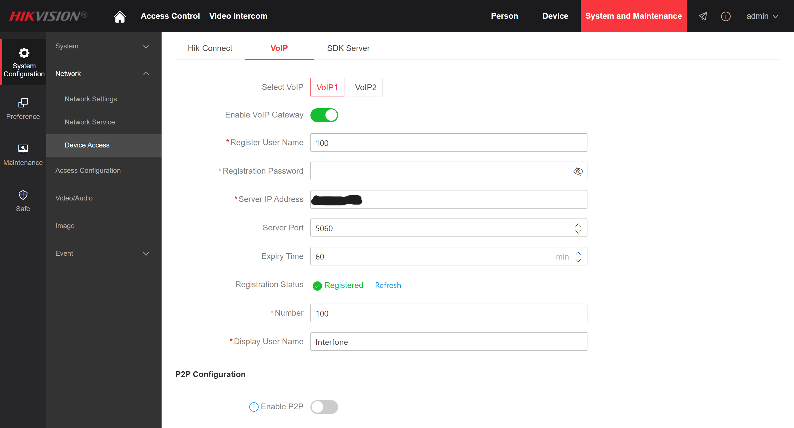
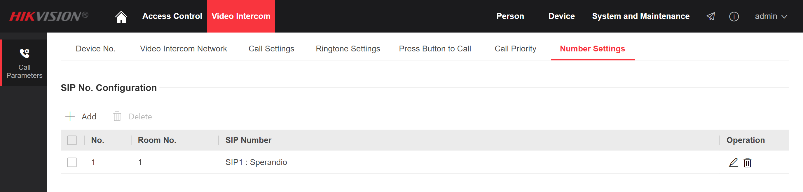
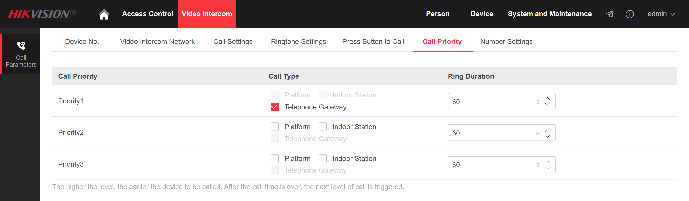

<p align="center">
  <picture>
    <source media="(prefers-color-scheme: dark)" srcset="https://raw.githubusercontent.com/webysther/ha-hikvision-virtual-indoor-station/main/custom_components/hikvision_virtual_indoor_station/brand/dark_logo@2x.png">
    
  </picture>
</p>

<h1 align="center">Hikvision Virtual Indoor Station</h1>

<p align="center">Home Assistant as the indoor station of your Hikvision video door station: answer, talk and open the door from dashboards and phones</p>

<p align="center">
  <a href="https://github.com/webysther/ha-hikvision-virtual-indoor-station/releases/latest"></a>
  <a href="https://www.home-assistant.io/integrations/marketplace/"></a>
  <a href="https://github.com/webysther/ha-hikvision-virtual-indoor-station/actions/workflows/tests.yaml"></a>
  <a href="https://github.com/webysther/ha-hikvision-virtual-indoor-station/blob/main/LICENSE"></a>
</p>

<p align="center"><b>English</b> · <a href="https://github.com/webysther/ha-hikvision-virtual-indoor-station/blob/main/README.it.md">Italiano</a> · <a href="https://github.com/webysther/ha-hikvision-virtual-indoor-station/blob/main/README.pt-BR.md">Português (Brasil)</a></p>

Make Home Assistant the indoor station of your Hikvision video door station. Its
button rings in Home Assistant, on your dashboards and phones: you answer, talk,
hang up or refuse the call, and open the door.

> **Status: in development.** Tested with a DS-KD8003-IME1(B), firmware V3.7.3.

## Why this integration

- **All in one.** The SIP server the door station calls, the card and a dashboard
  laid out like the screen of an indoor station come with the integration: no
  add-on, SIP server, MQTT broker or cloud account to set up next to it.
- **Hybrid, the best of each protocol.** SIP carries the call, as the door
  station expects from an indoor station; RTP carries your voice to the door, in
  the packets it plays best, and brings the visitor's voice back once answered;
  RTSP brings its picture, and its sound while you monitor; ISAPI opens the doors
  and talks through its speaker outside a call.
- **Platinum from day one.** It follows every rule of the top tier of the
  [integration quality scale](https://www.home-assistant.io/docs/quality_scale/):
  async, typed, fully tested, translated, with repairs, reauthentication and
  diagnostics. The protocol lives in its own library on PyPI,
  [aiohikvision](https://pypi.org/project/aiohikvision/).
- **Tested on real hardware.** Every behaviour it relies on was measured on a
  real door station (a DS-KD8003-IME1(B)), and calls are answered, refused and
  hung up on it.

## Features

- **The doorbell rings in Home Assistant.** The door station's VoIP line registers
  with Home Assistant and calls it: the visitor hears it ring, and the doorbell
  event fires.
- **Answer, hang up or refuse** from buttons, automations or the cards; every
  command names its call, so a late tap never touches the next visitor.
- **Talk to the visitor.** During a call your microphone goes to the door with the
  call; outside a call, through the door's speaker.
- **See and hear the visitor**: the camera of the door station, played with
  WebRTC, and the visitor's voice from the call itself once answered, in every
  browser (an iPad too).
- **Open the doors** wired to the door station, one button each.
- **Tune the door station** from Home Assistant: the image of its camera, its
  volumes, how long each door stays open and its voice prompt, within the ranges
  it reports.
- **Your phones ring with the door**: a notification with the door's picture,
  through focus modes, with **Answer**, **Open door** and **Reject** on it.
- **Knows when the door cannot call**: a sensor of the SIP registration, and a
  repair issue that says how to point the door station at Home Assistant.
- **Shows how loaded it is**: its CPU and how many clients stream its video, and
  what each input and output is wired for.
- **See when visitors come**: every visit is counted (answered, missed, refused),
  and two charts show the hours the door rings over the last 8 weeks and the
  visits of each of the last 28 days.

## Use cases

- A wall tablet or the phones of the household as the indoor station, with no
  Hikvision monitor and no cloud account.
- A notification with the visitor's picture when someone rings, and the door
  opened from it.
- Automations: a light at the door when it rings at night, the call refused while
  nobody is home, the gate opened for a known visitor.

## Installation

From the [Marketplace](https://www.home-assistant.io/integrations/marketplace/)
of Home Assistant:

[](https://my.home-assistant.io/redirect/marketplace_repository/?owner=webysther&repository=ha-hikvision-virtual-indoor-station&category=integration)

1. Open the link above, or **Settings → Marketplace → Add from link**, and add
   `https://github.com/webysther/ha-hikvision-virtual-indoor-station`.
2. Open **Hikvision Virtual Indoor Station** and install it.

Home Assistant 2026.10 or newer.

## Configuration

**Settings → Devices & services → Add integration → Hikvision Virtual Indoor
Station**, then:

| Field | What to give |
| --- | --- |
| Host | The IP address or name of the door station on your network |
| Username | An account of its web page (its admin account works) |
| Password | The password of that account |

Then point the door station at Home Assistant, in its web page:

1. **System and Maintenance → System Configuration → Network → Device Access →
   VoIP**, line **VoIP1**:
   - turn on **Enable VoIP Gateway**;
   - **Server IP Address**: the address of Home Assistant; **Server Port**:
     5060;
   - **Register User Name** and **Number**: a number for the door station, such
     as `100` (Home Assistant does not check the **Registration Password**);
   - **Display User Name**: a name for the door station;
   - **Expiry Time** can stay at 60 minutes: Home Assistant shortens it to 10;
   - leave **Enable P2P** off.

   Once saved, **Registration Status** shows **Registered**.

   

2. **Video Intercom → Call Parameters → Number Settings**: map the room of the
   call button (room 1) to the SIP line. The door's screen shows its name during
   calls.

   

3. **Video Intercom → Call Parameters → Call Priority**: **Telephone Gateway**
   as **Priority1**, so the button calls Home Assistant. Its **Ring Duration**
   is how long a call rings before it is missed.

   

4. Set the SIP audio to G.711 only.

The **SIP registration** sensor turns on once the door station registers. The
address, account and password can be changed later with **Reconfigure**.

Step by step, from the door station to the dashboard and the phones:
[the tutorial](https://github.com/webysther/ha-hikvision-virtual-indoor-station/blob/main/docs/tutorial.md).

## Dashboard and card

The integration brings its own card and dashboard: there is nothing else to
install.

- **The dashboard**: **Settings → Dashboards → Add dashboard → Hikvision Virtual
  Indoor Station**. It has a view for each door station, with its card, its
  activity (rings, calls, registration) and its visits: when the door rings (a
  24-hour clock of the last 8 weeks), the visits of each of the last 28 days
  (weekends shaded) and those of each week of the last quarter. Green is
  answered, amber missed and red refused, as the keys of the card.
- **The card**: **Hikvision Virtual Indoor Station** in the card picker of any
  dashboard, with a visual editor. It is laid out like the screen of an indoor
  station:
  - the door's camera, live while the door rings, during a call or while you
    monitor, and its picture otherwise; on top of it, the name of the door
    station and the state of the call while there is one;
  - **Answer** and **Reject** while the door rings, **Hang up** once answered,
    **Monitor** while idle, and **Mute ringer** for this browser;
  - **Push to talk**: hold it (or the space bar on it). Your voice goes with the
    call, or through the door's speaker while idle, and the door's sound is
    muted while you talk;
  - on the right of the same row, a key for each door that opens, and your
    shortcuts.

```yaml
type: custom:hikvision-indoor-station-card
# The door station (its device); the first one when left out
device_id: 0123456789abcdef0123456789abcdef
# hold (the default) or toggle: press once to talk, once to stop
talk_mode: hold
# Other entities: buttons are pressed, scenes and scripts turned on,
# automations triggered, the rest toggled
shortcuts:
  - light.porch
  - entity: scene.welcome
    name: Welcome
    icon: mdi:hand-wave
# false: the keys show their icons only
show_name: true
# false: no name and no call state on top of the camera
show_state: true
# false: hides that key
show_monitor: true
show_talk: true
show_ringer: true
# Keys per row (1 to 12), or rows of keys (1 to 4); without them, one
# row while they fit. A last row with fewer keys is centred
# columns: 3
# rows: 2
```

Browsers hold the sound of a page until it is tapped: the card asks for a tap
when the door rings before that. Phones also play the door's sound only from a
tap: **Answer** and **Monitor** turn it on, and when a call is answered from a
notification the card asks for a tap to hear the door. During a call the
visitor's voice comes from the call, not from the camera: a browser whose camera
player has no G.711 sound (an iPad, which plays the camera with HLS) hears them
too. Talking needs Home Assistant opened over HTTPS.

## Mobile apps

Each phone or tablet with the Home Assistant app (**Mobile App**, as Home Assistant
calls it) can ring with a door station: **Settings → Devices & services →
Hikvision Virtual Indoor Station**, then **Add mobile app** on the door station.

| Field | What it does |
| --- | --- |
| Mobile app | A device of the Home Assistant app (Mobile App) |
| Do not disturb | The mobile app is not notified when this door station rings |
| Can open the door | The notification has a button that opens the door |

The last two can be changed later (**Reconfigure** on the mobile app); adding or
changing one does not interrupt a call. When the door rings, each mobile app gets
a notification with the door's picture, delivered at once (time-sensitive on
iOS, high priority on Android), with:

- **Answer**: opens the indoor station panel, a page with the door station's
  card, which answers that call;
- **Open door**: opens the first door with a lock, in the background (an iPhone
  asks to be unlocked first);
- **Reject**: the door station shows busy.

The buttons work only while their call lasts, and the notification goes away
once the call is answered elsewhere, missed or over. A tap on the notification
opens the panel without answering. A mobile app that leaves Home Assistant has a
repair issue, whose fix removes it from the door station.

## Removal

**Settings → Devices & services → Hikvision Virtual Indoor Station**: **Delete**
in the three dots of the door station removes it, with its device and entities.
Then point the VoIP line of the door station elsewhere (or disable it), and
uninstall the integration from the Marketplace. A mobile app alone is removed
with **Delete** in the three dots of its line, under its door station. The
visits of a door station are forgotten with it.

## How the data is updated

- **Calls are pushed**, as they happen: the door station calls Home Assistant over
  SIP, and the call sensor, the doorbell event and the cards change at once.
- **Once a minute** the door station is asked what its outputs drive and how
  loaded it is (three small requests): its entities are unavailable while it does
  not answer, and a door whose output no longer drives a lock no longer opens.
- **Every 5 minutes** its settings and inputs are read: a door station streaming
  its video runs its CPU high, so what rarely changes is read less often. A
  setting changed from Home Assistant is read back at once.
- **The registration**: the door station registers every 10 minutes at most, and
  sends a keepalive every 20 seconds while it does.
- **The camera** streams on demand; its picture is taken when a dashboard asks.
- **The phones** are notified when the door rings, and the notification is taken
  back when the call is answered elsewhere, missed or over.
- **The visits** are counted as each call ends, and those of the last 8 weeks are
  kept in Home Assistant (when the door rang and how the call ended, nothing about
  the caller). The charts are drawn when a dashboard shows them.

## Known limitations

- **One SIP server, port 5060.** It cannot run next to another SIP server on the
  same port, such as the Voice over IP integration.
- **G.711 only.** The Opus and G.722.1 of the door stations are non-standard.
- **The talk time of the door station** ends the call (90 seconds by default):
  raise it in its web page.
- **Half duplex.** The door station's echo canceller lowers the visitor's voice
  while you talk: talk by turns.
- **Talking needs HTTPS** in the browser (the microphone).
- **Three buttons on Android**: a notification opens the first door with a lock
  only.
- **The notifications need the phone online**: they go through the push service
  of the Home Assistant app, which limits how many a phone gets a day.

## Troubleshooting

- **The button does not ring.** Check the **SIP registration** sensor. Off: the
  VoIP line does not point at Home Assistant (see Configuration), or port 5060 is
  blocked between them. A repair issue says the address and port to set.
- **Setup is retried, saying port 5060 is taken.** Another SIP server listens there:
  stop it, or the Voice over IP integration.
- **The door station beeps three times and shows nothing.** No SIP server answered:
  Home Assistant was off or unreachable.
- **No sound to the door, or a choppy one.** Set the SIP audio of the door station
  to G.711 only.
- **The call ends by itself after 90 seconds.** That is the talk time of the door
  station.
- **The button of door 2 is unavailable.** Its output rings a doorbell or drives
  nothing (see its **Output** sensor): set it to Electric Lock in the web page of
  the door station (Access Control → I/O Settings).
- **A phone does not ring.** Allow the notifications of the Home Assistant app on
  it, and check that it is not in **Do not disturb** for this door station. Its
  app must be signed in: Home Assistant then has its notify action
  (`notify.mobile_app_<its name>`).
- **The video takes long to start.** Turn on **Preload camera stream** in the
  settings of the door station's camera: its stream is then always ready (it
  keeps one stream of the door station open).
- **The video lags or freezes.** Look at **Video sessions** and **CPU usage**:
  every client that streams the door station (Home Assistant, a recorder, the
  Hik-Connect app) loads it, and with its CPU near 90% the video slows down.
  Stream it from fewer places, or play its **Sub stream** camera (turn it on
  first): a smaller picture, lighter for the door station and the phone.

Before opening an issue, turn on the debug logs (**Settings → Devices & services →
Hikvision Virtual Indoor Station → Enable debug logging**), restart the
integration, do what fails, then turn them off: Home Assistant downloads the log.
It is short and says what a fix needs, once: how the door station was recognised
(model, firmware, what it can do, the behaviours set for its model), what was set up
(doors, inputs, outputs, speaker, cameras, SIP), its streams, and each request that
fails. Attach it with the diagnostics (**Download diagnostics** on the device page):
they hold the door station's report, read without changing anything and without
addresses, names or the account.

## Supported devices

Hikvision video door stations with standard SIP (a VoIP line), such as the
DS-KD8003 series with firmware V3.7.1 build250709 or newer. Tested: DS-KD8003-IME1(B)
with V3.7.3. Other door stations of the DS-KD and DS-KV series are expected to work;
please report yours.

## Entities

| Entity | What it does |
| --- | --- |
| Camera | The door's picture and sound (RTSP), and snapshots: its main stream |
| Sub stream (camera, disabled by default) | The same, lighter to play (720p on a DS-KD8003); one camera per other stream of the door station |
| Doorbell (event) | `ring`, `answered`, `rejected`, `missed`, `ended`, with the call's id |
| Call (sensor) | `idle`, `ringing`, `answered` |
| SIP registration (diagnostic) | On while the door station can call Home Assistant |
| Open door (button) | One per door, numbered when there are several; unavailable while its output drives no lock |
| Output (diagnostic) | What a changeable output drives: `electric_lock`, `doorbell`, `disabled` |
| Input (diagnostic) | What a changeable input is wired for: `door_contact`, `exit_button`, `disabled` |
| CPU usage, Video sessions (diagnostic) | How loaded the door station is: its CPU, and how many clients stream its video |
| Visits, Missed visits (sensors) | How many visits came, and were missed: counters whose statistics give the visits of each day, week or month |
| Visits by hour, Visits by day (images) | Charts: when the door rings (24 hours, the last 8 weeks), and the visits of each of the last 28 days; green answered, amber missed, red refused |
| Answer, Hang up, Reject (buttons) | Act on the current call |
| Microphone volume, Speaker volume, Call volume (configuration) | The volumes of the door station |
| Door open time (configuration) | How long a door stays open, in seconds; one per door |
| Voice prompt when a door opens, Door voice prompt (configuration) | Whether the door station speaks when a door opens, and what: `long`, `short`, `doorisopen` |
| Day/night mode, Brightness, Contrast, Saturation, Sharpness, WDR (configuration) | The image of the camera |

The settings appear when the door station offers them, with its ranges and
choices. Day/night sensitivity, WDR level, Backlight compensation, its area and
Power line frequency are there too, disabled by default.

## Automation examples

A notification when someone rings (each event changes the state of the doorbell,
even two rings in a row):

```yaml
triggers:
  - trigger: state
    entity_id: event.door_station_doorbell
    not_from: [unavailable, unknown]
conditions:
  - condition: template
    value_template: "{{ trigger.to_state.attributes.event_type == 'ring' }}"
actions:
  - action: notify.notify
    data:
      title: Someone is at the door
      message: "{{ now().strftime('%H:%M') }}"
```

Refuse the calls while nobody is home:

```yaml
triggers:
  - trigger: state
    entity_id: sensor.door_station_call
    to: ringing
conditions:
  - condition: state
    entity_id: zone.home
    state: "0"
actions:
  - action: button.press
    target:
      entity_id: button.door_station_reject
```

## Contributing

See [AGENTS.md](https://github.com/webysther/ha-hikvision-virtual-indoor-station/blob/main/AGENTS.md):
how the integration is laid out, its checks and its conventions. The protocol lives
in [aiohikvision](https://github.com/webysther/aio-hikvision).

## Related projects

Other projects that bring Hikvision devices to Home Assistant. If you use one of
them for a door station, give this integration a try: it does the indoor station
in one integration, locally, with no add-on, MQTT broker or cloud account. For
cameras and recorders, try [Hikvision Bridge](https://github.com/yannik2480/hikvision_bridge),
which can be installed next to this integration.

Door stations and intercoms:

- [Hikvision Bridge](https://github.com/yannik2480/hikvision_bridge): cameras,
  recorders and door stations over local ISAPI (events, live streams,
  recordings, doors). The ISAPI code of
  [aiohikvision](https://github.com/webysther/aio-hikvision) comes from it.
- [Hikvision-Addons](https://github.com/pergolafabio/Hikvision-Addons): an add-on
  built on the Hikvision SDK that exposes the doorbell over MQTT, to answer,
  refuse and hang up calls and open the doors.
- [SIP Indoor Station](https://github.com/arturzx/sip-indoor-station): a SIP
  server and WebRTC audio bridge for SIP door stations, with its
  [integration](https://github.com/arturzx/sip-indoor-station-integration),
  [card](https://github.com/arturzx/sip-indoor-station-card) and
  [add-on](https://github.com/arturzx/hass-addons) in separate repositories.
- [Hikvision Doorbell Integration](https://github.com/acardace/hikvision-doorbell-integration):
  WebRTC two-way audio over ISAPI, with its
  [server](https://github.com/acardace/hikvision-doorbell-server).
- [Hikvision Intercom](https://github.com/schmidt-gabriel/hikvision-intercom-hass-integration):
  doorbell detection and doors over ISAPI.
- [Hikvision Intercom (2-wire)](https://github.com/TimLuist1/hikvision-intercom):
  2-wire intercoms through the Hikvision SDK.
- [Hik-Connect](https://github.com/tomasbedrich/home-assistant-hikconnect): smart
  doorbells through the Hik-Connect cloud.
- [Intercom HomeKit](https://github.com/DmytryS/intercom-homekit): an add-on
  that makes a door station an Apple HomeKit video doorbell.

Cameras and recorders:

- [Hikvision](https://www.home-assistant.io/integrations/hikvision/), the
  integration that ships with Home Assistant, built on
  [pyHik](https://github.com/mezz64/pyHik).
- [Hikvision NVR / IP cameras](https://github.com/maciej-or/hikvision_next)
  (`hikvision_next`).

## License

The code is under the
[MIT License](https://github.com/webysther/ha-hikvision-virtual-indoor-station/blob/main/LICENSE).

Hikvision and Home Assistant are trademarks of their owners, named here only to
identify them, without implying their endorsement; this project is not affiliated
with Hikvision. The icon of the integration is original art.
