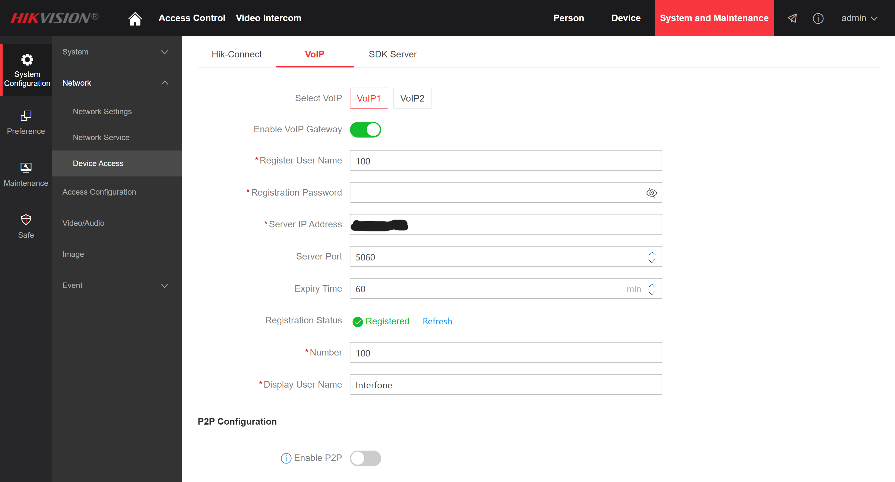
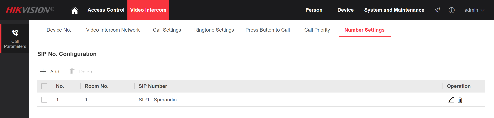
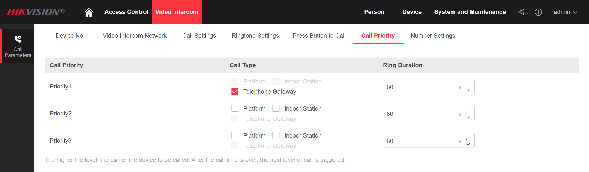

<p align="center">
  <picture>
    <source media="(prefers-color-scheme: dark)" srcset="https://raw.githubusercontent.com/webysther/ha-hikvision-virtual-indoor-station/main/custom_components/hikvision_virtual_indoor_station/brand/dark_logo@2x.png">
    
  </picture>
</p>

<h1 align="center">Hikvision Virtual Indoor Station</h1>

<p align="center">O Home Assistant como monitor interno do seu porteiro eletrônico Hikvision: atenda, fale e abra a porta pelos dashboards e celulares</p>

<p align="center">
  <a href="https://github.com/webysther/ha-hikvision-virtual-indoor-station/releases/latest"></a>
  <a href="https://www.home-assistant.io/integrations/marketplace/"></a>
  <a href="https://github.com/webysther/ha-hikvision-virtual-indoor-station/actions/workflows/tests.yaml"></a>
  <a href="https://github.com/webysther/ha-hikvision-virtual-indoor-station/blob/main/LICENSE"></a>
</p>

<p align="center"><a href="https://github.com/webysther/ha-hikvision-virtual-indoor-station/blob/main/README.md">English</a> · <a href="https://github.com/webysther/ha-hikvision-virtual-indoor-station/blob/main/README.it.md">Italiano</a> · <b>Português (Brasil)</b></p>

Faça do Home Assistant o monitor interno do seu porteiro eletrônico Hikvision. O
botão do porteiro toca no Home Assistant, nos seus dashboards e celulares: você
atende, fala, desliga ou recusa a chamada, e abre a porta.

> **Status: em desenvolvimento.** Testado com um DS-KD8003-IME1(B), firmware
> V3.7.3.

## Por que esta integração

- **Tudo em um.** O servidor SIP para onde o porteiro liga, o card e um dashboard
  com a cara da tela de um monitor interno vêm com a integração: nada de add-on,
  servidor SIP, broker MQTT ou conta na nuvem para configurar ao lado.
- **Híbrida, o melhor de cada protocolo.** O SIP leva a chamada, como o porteiro
  espera de um monitor interno; o RTP leva a sua voz até a porta, nos pacotes que
  ela toca melhor, e traz de volta a voz do visitante depois de atendida; o RTSP
  traz a imagem, e o som enquanto você monitora; o ISAPI abre as portas e fala
  pelo alto-falante fora de uma chamada.
- **Platinum desde o primeiro dia.** Segue todas as regras do nível mais alto da
  [escala de qualidade de integrações](https://www.home-assistant.io/docs/quality_scale/):
  assíncrona, tipada, toda testada, traduzida, com reparos, reautenticação e
  diagnóstico. O protocolo fica numa biblioteca própria no PyPI, o
  [aiohikvision](https://pypi.org/project/aiohikvision/).
- **Testada em hardware real.** Cada comportamento de que ela depende foi medido
  num porteiro de verdade (um DS-KD8003-IME1(B)), e as chamadas são atendidas,
  recusadas e desligadas nele.

## Recursos

- **A campainha toca no Home Assistant.** A linha VoIP do porteiro se registra no
  Home Assistant e liga para ele: o visitante ouve chamar, e o evento da
  campainha dispara.
- **Atenda, desligue ou recuse** pelos botões, por automações ou pelos cards;
  todo comando leva o id da sua chamada, então um toque atrasado nunca atinge o
  próximo visitante.
- **Fale com o visitante.** Durante uma chamada, o seu microfone vai para a porta
  junto com a chamada; fora dela, pelo alto-falante do porteiro.
- **Veja e ouça o visitante**: a câmera do porteiro, tocada por WebRTC, e a voz
  do visitante pela própria chamada depois de atendida, em qualquer navegador
  (inclusive no iPad).
- **Abra as portas** ligadas ao porteiro, um botão para cada uma.
- **Ajuste o porteiro** pelo Home Assistant: a imagem da câmera, os volumes, o
  tempo que cada porta fica aberta e o aviso de voz, dentro das faixas que ele
  informa.
- **Os seus celulares tocam junto com a porta**: uma notificação com a foto da
  porta, mesmo em modo foco, com **Atender**, **Abrir porta** e **Recusar**.
- **Sabe quando a porta não consegue chamar**: um sensor do registro SIP e um
  reparo que explica como apontar o porteiro para o Home Assistant.
- **Mostra o quanto ele está carregado**: a CPU e quantos clientes transmitem o
  vídeo dele, e para que serve cada entrada e cada saída.
- **Veja quando as visitas chegam**: cada visita é contada (atendida, perdida,
  recusada), e dois gráficos mostram as horas em que a porta toca nas últimas 8
  semanas e as visitas de cada um dos últimos 28 dias.

## Casos de uso

- Um tablet na parede ou os celulares da casa como monitor interno, sem monitor
  Hikvision e sem conta na nuvem.
- Uma notificação com a foto do visitante quando alguém toca, e a porta aberta
  por ela.
- Automações: acender a luz da entrada quando tocar à noite, recusar as chamadas
  quando não houver ninguém em casa, abrir o portão para um visitante conhecido.

## Instalação

Pelo [Marketplace](https://www.home-assistant.io/integrations/marketplace/) do
Home Assistant:

[](https://my.home-assistant.io/redirect/marketplace_repository/?owner=webysther&repository=ha-hikvision-virtual-indoor-station&category=integration)

1. Abra o link acima, ou **Configurações → Marketplace → Adicionar por link**, e
   adicione `https://github.com/webysther/ha-hikvision-virtual-indoor-station`.
2. Abra **Hikvision Virtual Indoor Station** e instale.

Home Assistant 2026.10 ou mais novo.

## Configuração

**Configurações → Dispositivos e serviços → Adicionar integração → Hikvision
Virtual Indoor Station**, e então:

| Campo | O que informar |
| --- | --- |
| Host | O endereço IP ou o nome do porteiro na sua rede |
| Usuário | Uma conta da página web dele (a conta admin serve) |
| Senha | A senha dessa conta |

Depois aponte o porteiro para o Home Assistant, na página web dele:

1. **System and Maintenance → System Configuration → Network → Device Access →
   VoIP**, linha **VoIP1**:
   - ligue **Enable VoIP Gateway**;
   - **Server IP Address**: o endereço do Home Assistant; **Server Port**: 5060;
   - **Register User Name** e **Number**: um número para o porteiro, como `100`
     (o Home Assistant não confere a **Registration Password**);
   - **Display User Name**: um nome para o porteiro;
   - **Expiry Time** pode ficar em 60 minutos: o Home Assistant reduz para 10;
   - deixe **Enable P2P** desligado.

   Depois de salvar, **Registration Status** mostra **Registered**.

   

2. **Video Intercom → Call Parameters → Number Settings**: ligue a sala do botão
   de chamada (sala 1) à linha SIP. A tela do porteiro mostra o nome dela durante
   as chamadas.

   

3. **Video Intercom → Call Parameters → Call Priority**: **Telephone Gateway**
   como **Priority1**, para o botão ligar para o Home Assistant. O **Ring
   Duration** é quanto tempo a chamada toca até ser perdida.

   

4. Deixe o áudio SIP só em G.711.

O sensor **SIP registration** liga quando o porteiro se registra. O endereço, a
conta e a senha podem ser trocados depois em **Reconfigurar**.

Passo a passo, do porteiro ao dashboard e aos celulares:
[o tutorial](https://github.com/webysther/ha-hikvision-virtual-indoor-station/blob/main/docs/tutorial.md) (em inglês).

## Dashboard e card

A integração traz o próprio card e o próprio dashboard: não há mais nada para
instalar.

- **O dashboard**: **Configurações → Painéis → Adicionar painel → Hikvision
  Virtual Indoor Station**. Ele tem uma aba para cada porteiro, com o card, a
  atividade dele (toques, chamadas, registro) e as visitas: quando a porta toca
  (um relógio de 24 horas das últimas 8 semanas), as visitas de cada um dos
  últimos 28 dias (com os fins de semana sombreados) e as de cada semana do
  último trimestre. Verde é atendida, âmbar perdida e vermelho recusada, como as
  teclas do card.
- **O card**: **Hikvision Virtual Indoor Station** no seletor de cards de
  qualquer dashboard, com editor visual. Ele tem a cara da tela de um monitor
  interno:
  - a câmera da porta, ao vivo enquanto a porta toca, durante uma chamada ou
    enquanto você monitora, e a foto dela no resto do tempo; em cima dela, o
    nome do porteiro e o estado da chamada, quando há uma;
  - **Atender** e **Recusar** enquanto a porta toca, **Desligar** depois de
    atender, **Monitorar** com a porta livre, e **Silenciar campainha** neste
    navegador;
  - **Aperte para falar**: segure o botão (ou a barra de espaço com ele em
    foco). A sua voz vai com a chamada, ou pelo alto-falante da porta quando ela
    está livre, e o som da porta fica mudo enquanto você fala;
  - à direita, na mesma linha, uma chave para cada porta que abre, e os seus
    atalhos.

```yaml
type: custom:hikvision-indoor-station-card
# O porteiro (o dispositivo dele); sem ele, o primeiro
device_id: 0123456789abcdef0123456789abcdef
# hold (o padrão) ou toggle: aperte uma vez para falar, outra para parar
talk_mode: hold
# Outras entidades: botões são pressionados, cenas e scripts ligados,
# automações disparadas, o resto alternado
shortcuts:
  - light.porch
  - entity: scene.welcome
    name: Bem-vindo
    icon: mdi:hand-wave
# false: as teclas mostram só os ícones
show_name: true
# false: sem o nome e o estado da chamada em cima da câmera
show_state: true
# false: esconde essa tecla
show_monitor: true
show_talk: true
show_ringer: true
# Teclas por linha (1 a 12), ou linhas de teclas (1 a 4); sem eles, uma
# linha enquanto couberem. Uma última linha com menos teclas fica centralizada
# columns: 3
# rows: 2
```

Os navegadores seguram o som de uma página até alguém tocar nela: o card pede um
toque quando a porta toca antes disso. Os celulares também só tocam o som da porta
a partir de um toque: **Atender** e **Monitorar** ligam o som, e quando a chamada
é atendida pela notificação o card pede um toque para ouvir a porta. Durante uma
chamada, a voz do visitante vem da chamada, não da câmera: um navegador cujo
player da câmera não tem o som G.711 (o iPad, que toca a câmera por HLS) também
ouve. Para falar, o Home Assistant precisa estar aberto por HTTPS.

## Aplicativos móveis

Cada celular ou tablet com o app do Home Assistant (**Aplicativo móvel**, como o
Home Assistant o chama) pode tocar junto com um porteiro: **Configurações →
Dispositivos e serviços → Hikvision Virtual Indoor Station**, e **Adicionar
aplicativo móvel** no porteiro.

| Campo | O que faz |
| --- | --- |
| Aplicativo móvel | Um dispositivo do app do Home Assistant (Aplicativo móvel) |
| Não perturbe | O aplicativo móvel não é avisado quando este porteiro toca |
| Pode abrir a porta | A notificação tem um botão que abre a porta |

Os dois últimos podem ser mudados depois (**Reconfigurar** no aplicativo móvel);
adicionar ou mudar um não interrompe uma chamada. Quando a porta toca, cada
aplicativo móvel recebe uma notificação com a foto da porta, entregue na hora
(time-sensitive no iOS, prioridade alta no Android), com:

- **Atender**: abre o painel do monitor interno, uma página com o card do
  porteiro, que atende aquela chamada;
- **Abrir porta**: abre a primeira porta com fechadura, em segundo plano (o
  iPhone pede para ser desbloqueado antes);
- **Recusar**: o porteiro mostra ocupado.

Os botões só funcionam enquanto dura a chamada deles, e a notificação some quando
a chamada é atendida em outro lugar, perdida ou encerrada. Um toque na
notificação abre o painel sem atender. Um aplicativo móvel que sai do Home
Assistant ganha um reparo, que o remove do porteiro.

## Remoção

**Configurações → Dispositivos e serviços → Hikvision Virtual Indoor Station**:
**Excluir**, nos três pontinhos do porteiro, remove o porteiro com o dispositivo
e as entidades dele. Depois aponte a linha VoIP do porteiro para outro lugar (ou
desligue-a) e desinstale a integração pelo Marketplace. Um aplicativo móvel
sozinho é removido com **Excluir** nos três pontinhos da linha dele, debaixo do
porteiro. As visitas de um porteiro são esquecidas junto com ele.

## Como os dados são atualizados

- **As chamadas chegam na hora**: o porteiro liga para o Home Assistant por SIP,
  e o sensor de chamada, o evento da campainha e os cards mudam no mesmo
  instante.
- **Uma vez por minuto** o porteiro é perguntado o que as saídas dele acionam e
  o quanto ele está carregado (três requisições pequenas): as entidades dele
  ficam indisponíveis enquanto ele não responde, e uma porta cuja saída deixou de
  acionar uma fechadura deixa de abrir.
- **A cada 5 minutos** as configurações e as entradas dele são lidas: um porteiro
  transmitindo o vídeo fica com a CPU alta, então o que muda pouco é lido com
  menos frequência. Uma configuração alterada pelo Home Assistant é relida na
  hora.
- **O registro**: o porteiro se registra a cada 10 minutos no máximo, e manda um
  keepalive a cada 20 segundos enquanto está registrado.
- **A câmera** transmite sob demanda; a foto dela é tirada quando um dashboard
  pede.
- **Os celulares** são avisados quando a porta toca, e a notificação é retirada
  quando a chamada é atendida em outro lugar, perdida ou encerrada.
- **As visitas** são contadas quando cada chamada termina, e as das últimas 8
  semanas ficam guardadas no Home Assistant (quando a porta tocou e como a
  chamada terminou, nada sobre quem tocou). Os gráficos são desenhados quando um
  dashboard os mostra.

## Limitações conhecidas

- **Um servidor SIP, porta 5060.** A integração não roda ao lado de outro
  servidor SIP na mesma porta, como a integração Voice over IP.
- **Só G.711.** O Opus e o G.722.1 dos porteiros não seguem o padrão.
- **O tempo de conversa do porteiro** encerra a chamada (90 segundos por padrão):
  aumente-o na página web dele.
- **Half duplex.** O cancelador de eco do porteiro abaixa a voz do visitante
  enquanto você fala: falem um de cada vez.
- **Para falar, é preciso HTTPS** no navegador (por causa do microfone).
- **Três botões no Android**: uma notificação só abre a primeira porta com
  fechadura.
- **As notificações precisam do celular online**: elas passam pelo serviço de
  push do app do Home Assistant, que limita quantas um celular recebe por dia.

## Solução de problemas

- **O botão não toca.** Veja o sensor **SIP registration**. Desligado: a linha
  VoIP não aponta para o Home Assistant (veja Configuração), ou a porta 5060 está
  bloqueada entre eles. Um reparo informa o endereço e a porta a configurar.
- **A configuração é tentada de novo, dizendo que a porta 5060 está ocupada.**
  Outro servidor SIP escuta nela: pare-o, ou pare a integração Voice over IP.
- **O porteiro apita três vezes e não mostra nada.** Nenhum servidor SIP
  respondeu: o Home Assistant estava desligado ou inacessível.
- **Sem som na porta, ou com som picotado.** Deixe o áudio SIP do porteiro só em
  G.711.
- **A chamada cai sozinha depois de 90 segundos.** É o tempo de conversa do
  porteiro.
- **O botão da porta 2 está indisponível.** A saída dela aciona uma campainha ou
  nada (veja o sensor **Output** dela): mude para Electric Lock na página web do
  porteiro (Access Control → I/O Settings).
- **Um celular não toca.** Permita as notificações do app do Home Assistant nele,
  e veja se ele não está em **Não perturbe** para este porteiro. O app dele
  precisa estar conectado: aí o Home Assistant tem a ação de notificação dele
  (`notify.mobile_app_<nome dele>`).
- **O vídeo demora a começar.** Ligue **Pré-carregar o fluxo da câmera** nas
  configurações da câmera do porteiro: o fluxo dela fica sempre pronto (ele
  mantém um fluxo do porteiro aberto).
- **O vídeo atrasa ou trava.** Veja **Video sessions** e **CPU usage**: cada
  cliente que transmite o porteiro (o Home Assistant, um gravador, o app
  Hik-Connect) pesa nele, e com a CPU perto de 90% o vídeo fica lento. Transmita
  de menos lugares.

Ative os logs de depuração (**Configurações → Dispositivos e serviços →
Hikvision Virtual Indoor Station → Habilitar registro de depuração**) e baixe os
diagnósticos antes de abrir uma issue: eles omitem endereços, nomes e a conta.

## Dispositivos suportados

Porteiros eletrônicos Hikvision com SIP padrão (uma linha VoIP), como a série
DS-KD8003 com firmware V3.7.1 build250709 ou mais novo. Testado: DS-KD8003-IME1(B)
com V3.7.3. Outros porteiros das séries DS-KD e DS-KV devem funcionar; por favor,
conte como foi com o seu.

## Entidades

| Entidade | O que faz |
| --- | --- |
| Câmera | A imagem e o som da porta (RTSP), e as fotos |
| Doorbell (evento) | `ring`, `answered`, `rejected`, `missed`, `ended`, com o id da chamada |
| Call (sensor) | `idle`, `ringing`, `answered` |
| SIP registration (diagnóstico) | Ligado enquanto o porteiro consegue chamar o Home Assistant |
| Open door (botão) | Um por porta, numerado quando há mais de uma; indisponível enquanto a saída dela não aciona uma fechadura |
| Output (diagnóstico) | O que uma saída configurável aciona: `electric_lock`, `doorbell`, `disabled` |
| Input (diagnóstico) | Para que serve uma entrada configurável: `door_contact`, `exit_button`, `disabled` |
| CPU usage, Video sessions (diagnóstico) | O quanto o porteiro está carregado: a CPU, e quantos clientes transmitem o vídeo dele |
| Visits, Missed visits (sensores) | Quantas visitas chegaram, e quantas foram perdidas: contadores cujas estatísticas dão as visitas de cada dia, semana ou mês |
| Visits by hour, Visits by day (imagens) | Gráficos: quando a porta toca (24 horas, as últimas 8 semanas) e as visitas de cada um dos últimos 28 dias; verde atendida, âmbar perdida, vermelho recusada |
| Answer, Hang up, Reject (botões) | Agem na chamada atual |
| Microphone volume, Speaker volume, Call volume (configuração) | Os volumes do porteiro |
| Door open time (configuração) | Quanto tempo uma porta fica aberta, em segundos; uma por porta |
| Voice prompt when a door opens, Door voice prompt (configuração) | Se o porteiro fala quando uma porta abre, e o quê: `long`, `short`, `doorisopen` |
| Day/night mode, Brightness, Contrast, Saturation, Sharpness, WDR (configuração) | A imagem da câmera |

As configurações aparecem quando o porteiro as oferece, com as faixas e as
opções dele. Também há Day/night sensitivity, WDR level, Backlight compensation,
a área dela e Power line frequency, desativadas por padrão.

Os nomes das entidades seguem o idioma do Home Assistant.

## Exemplos de automação

Uma notificação quando alguém toca (cada evento muda o estado da campainha, até
dois toques seguidos):

```yaml
triggers:
  - trigger: state
    entity_id: event.door_station_doorbell
    not_from: [unavailable, unknown]
conditions:
  - condition: template
    value_template: "{{ trigger.to_state.attributes.event_type == 'ring' }}"
actions:
  - action: notify.notify
    data:
      title: Tem alguém na porta
      message: "{{ now().strftime('%H:%M') }}"
```

Recusar as chamadas quando não houver ninguém em casa:

```yaml
triggers:
  - trigger: state
    entity_id: sensor.door_station_call
    to: ringing
conditions:
  - condition: state
    entity_id: zone.home
    state: "0"
actions:
  - action: button.press
    target:
      entity_id: button.door_station_reject
```

## Como contribuir

Veja o [AGENTS.md](https://github.com/webysther/ha-hikvision-virtual-indoor-station/blob/main/AGENTS.md)
(em inglês): como a integração é organizada, as verificações e as convenções. O
protocolo fica no [aiohikvision](https://github.com/webysther/aio-hikvision).

## Projetos relacionados

Outros projetos que levam aparelhos Hikvision ao Home Assistant. Se você usa um
deles para um porteiro, experimente esta integração: ela faz o monitor interno
numa integração só, localmente, sem add-on, broker MQTT ou conta na nuvem. Para
câmeras e gravadores, experimente a
[Hikvision Bridge](https://github.com/yannik2480/hikvision_bridge), que pode ficar
instalada ao lado desta integração.

Porteiros e interfones:

- [Hikvision Bridge](https://github.com/yannik2480/hikvision_bridge): câmeras,
  gravadores e porteiros por ISAPI local (eventos, transmissões ao vivo,
  gravações, portas). O código ISAPI do
  [aiohikvision](https://github.com/webysther/aio-hikvision) vem dela.
- [Hikvision-Addons](https://github.com/pergolafabio/Hikvision-Addons): um add-on
  feito sobre o SDK da Hikvision que expõe a campainha por MQTT, para atender,
  recusar e desligar chamadas e abrir as portas.
- [SIP Indoor Station](https://github.com/arturzx/sip-indoor-station): um
  servidor SIP e uma ponte de áudio WebRTC para porteiros SIP, com a
  [integração](https://github.com/arturzx/sip-indoor-station-integration), o
  [card](https://github.com/arturzx/sip-indoor-station-card) e o
  [add-on](https://github.com/arturzx/hass-addons) em repositórios separados.
- [Hikvision Doorbell Integration](https://github.com/acardace/hikvision-doorbell-integration):
  áudio bidirecional por WebRTC sobre ISAPI, com o
  [servidor](https://github.com/acardace/hikvision-doorbell-server) dela.
- [Hikvision Intercom](https://github.com/schmidt-gabriel/hikvision-intercom-hass-integration):
  detecção da campainha e portas por ISAPI.
- [Hikvision Intercom (2 fios)](https://github.com/TimLuist1/hikvision-intercom):
  interfones de 2 fios pelo SDK da Hikvision.
- [Hik-Connect](https://github.com/tomasbedrich/home-assistant-hikconnect):
  campainhas inteligentes pela nuvem Hik-Connect.
- [Intercom HomeKit](https://github.com/DmytryS/intercom-homekit): um add-on que
  transforma o porteiro numa campainha com vídeo do Apple HomeKit.

Câmeras e gravadores:

- [Hikvision](https://www.home-assistant.io/integrations/hikvision/), a
  integração que vem com o Home Assistant, feita sobre o
  [pyHik](https://github.com/mezz64/pyHik).
- [Hikvision NVR / IP cameras](https://github.com/maciej-or/hikvision_next)
  (`hikvision_next`).

## Licença

O código está sob a
[Licença MIT](https://github.com/webysther/ha-hikvision-virtual-indoor-station/blob/main/LICENSE).

Hikvision e Home Assistant são marcas dos seus donos, citadas aqui só para
identificá-las, sem sugerir o apoio delas; este projeto não tem vínculo com a
Hikvision. O ícone da integração é arte original.
