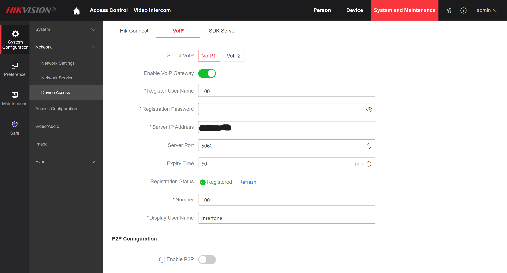
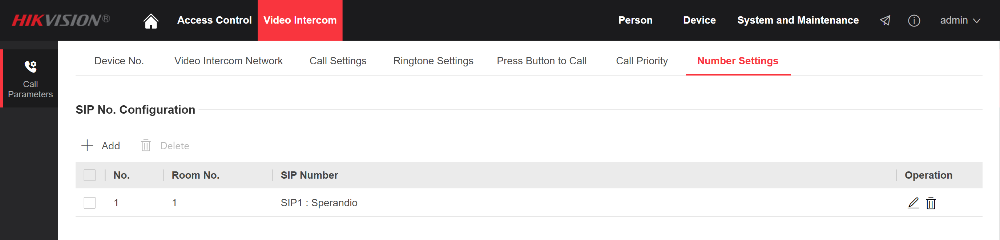
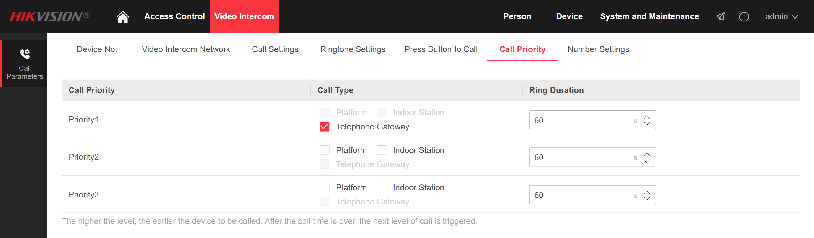

# Turn Home Assistant into the indoor station of your Hikvision door station

A Hikvision video door station usually rings an indoor station on the wall, or the
Hik-Connect app through the cloud. This tutorial makes Home Assistant that indoor
station instead, on your own network:

- the door's button rings in Home Assistant, on a wall tablet and on your phones;
- you see and hear the visitor, answer, talk (push-to-talk) and hang up;
- the door opens from a dashboard, an automation or the phone's notification.

It takes about fifteen minutes: install the integration, add the door station, point
its VoIP line at Home Assistant, then add the dashboard and the phones.

## What you need

- **A Hikvision video door station with a VoIP line** (standard SIP), such as the
  DS-KD8003 series with firmware V3.7.1 build250709 or newer. This tutorial was
  written on a DS-KD8003-IME1(B) with V3.7.3; the menus of other models may differ
  a little.
- **Its address and an account of its web page.** The admin account works.
- **Home Assistant 2026.10 or newer**, which the door station reaches on UDP port
  5060. Nothing else may listen on that port: the Voice over IP integration does,
  so it cannot run alongside.
- **HTTPS** to talk from a browser (browsers give the microphone to secure pages
  only), and **the Home Assistant app** on the phones that should ring.

## 1. Install the integration

In Home Assistant, **Settings → Marketplace → Add from link**, add
`https://github.com/webysther/ha-hikvision-virtual-indoor-station`, then open
**Hikvision Virtual Indoor Station** and install it. Restart Home Assistant when it
asks.

## 2. Add the door station

**Settings → Devices & services → Add integration → Hikvision Virtual Indoor
Station**, and give:

- **Host**: the IP address or name of the door station;
- **Username** and **Password**: an account of its web page.

Home Assistant checks that the device answers and is a door station, then adds it
with its camera, doorbell, call sensor, SIP registration sensor and buttons.

## 3. Point the door station at Home Assistant

Open the web page of the door station.

**The VoIP line.** In **System and Maintenance → System Configuration → Network →
Device Access → VoIP**, choose **VoIP1**:

- turn on **Enable VoIP Gateway**;
- **Server IP Address**: the address of Home Assistant; **Server Port**: 5060;
- **Register User Name** and **Number**: a number for the door station, such as
  `100`; Home Assistant does not check the **Registration Password**;
- **Display User Name**: a name for the door station;
- **Expiry Time** can stay at 60 minutes: Home Assistant shortens it to 10;
- leave **Enable P2P** off.

Save. Within seconds, **Registration Status** shows **Registered**, and the **SIP
registration** sensor of the door station turns on in Home Assistant.

**Which line the button calls.** In **Video Intercom → Call Parameters → Number
Settings**, map the room of the call button (room 1) to the SIP line. The door's
screen shows that line's name during calls.

**Call Home Assistant first.** In **Video Intercom → Call Parameters → Call
Priority**, tick **Telephone Gateway** as **Priority1**. Its **Ring Duration** is
how long a call rings before it counts as missed.

**The audio.** Set the SIP audio of the door station to G.711 only. Its other
codecs are not standard, and Home Assistant speaks G.711.

**How long a call may last.** The door station ends every call after its talk time,
90 seconds by default. If that is too short, raise it in its Video Intercom
settings (up to 1800 seconds).

## 4. Ring the door

Press the button on the door station. In Home Assistant:

- the **Call** sensor turns to `ringing`, and the **Doorbell** event fires `ring`;
- **Answer** answers it, **Reject** refuses it (the door station shows busy), and
  **Hang up** ends an answered call;
- after the call, the doorbell tells how it went: `answered`, `rejected`, `missed`
  or `ended`.

If nothing rings, check the **SIP registration** sensor first: off means the VoIP
line does not reach Home Assistant. After ten minutes without it, a repair issue
says the address and port to set.

## 5. Add the dashboard

**Settings → Dashboards → Add dashboard → Hikvision Virtual Indoor Station**. It has
a view for each door station, with its card and its activity. The card can also go
on any dashboard: look for **Hikvision Virtual Indoor Station** in the card picker.

On the card:

- the camera plays live while the door rings, during a call, or when you press
  **Monitor**; otherwise it shows the door's picture;
- **Answer** (green) and **Reject** while it rings, **Hang up** (red) once
  answered;
- **Push to talk**: hold it while you speak. During a call your voice goes with
  the call; outside a call, through the door's speaker. The door station hears and
  speaks by turns, so the card mutes the door while you talk;
- a key for each door, and shortcuts to other entities, such as the porch light.

Browsers play a page's sound only after a tap on it: tap the card once, and it can
ring. If the video takes long to start, turn on **Preload camera stream** in the
settings of the door station's camera.

## 6. Make the phones ring

On **Settings → Devices & services → Hikvision Virtual Indoor Station**, choose
**Add phone** on the door station, pick a phone with the Home Assistant app, and
decide whether it may open the door. Each phone can also be put in **Do not
disturb** for this door station.

When the door rings, each phone gets a notification with the door's picture, even
through focus modes, with three buttons:

- **Answer** opens a page with the door station's card, which answers the call;
- **Open door** opens the door without opening the app (an iPhone asks to be
  unlocked first);
- **Reject** refuses the call.

The buttons work only while their call lasts, and the notification goes away when
someone else answers, or when the call is missed or over.

## 7. Automate

The doorbell event and the call sensor work in automations like any other entity.
A few ideas:

- turn on the porch light when the door rings after sunset;
- refuse the call while nobody is home (press **Reject**);
- open the gate when a known visitor rings, with the **Open door** button.

The README has these as YAML, under **Automation examples**.

## When something goes wrong

- **The door station beeps three times and shows nothing**: no SIP server answered.
  Home Assistant was off or unreachable, or port 5060 is blocked between them.
- **Setup is retried, saying port 5060 is taken**: another SIP server listens
  there, such as the Voice over IP integration.
- **No sound to the door, or a choppy one**: set the SIP audio to G.711 only.
- **The call ends after 90 seconds**: that is the talk time of the door station.
- **A phone does not ring**: allow the notifications of the Home Assistant app on
  it, and check that it is not in **Do not disturb**.

The README's **Troubleshooting** has more. Before opening an issue, enable debug
logging on the integration and download its diagnostics: they leave out addresses,
names and the account.
